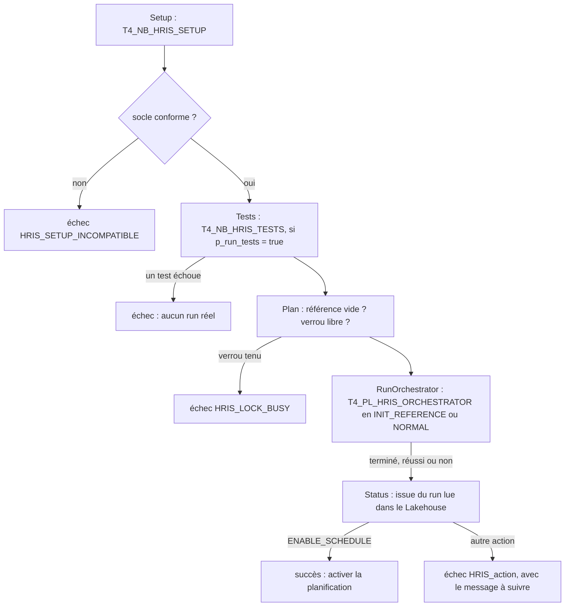

# Traitements ponctuels — premier chargement, installation, codes ADP

Ce document détaille le dossier `ONESHOT` : ce qui se lance **à la main**. Vue d'ensemble : [README](../README.md) ·
pipeline quotidien : [QUOTIDIEN](../QUOTIDIEN/README_DETAILS.md) · tests : [TESTS](../TESTS/README_DETAILS.md).

**Sommaire** — [Contenu](#contenu) · [Premier chargement](#premier-chargement) · [Installation](#setup) ·
[Codes ADP](#codes-adp) · [Git et Fabric](#git)

---

<a id="contenu"></a>
## Contenu du dossier

| Objet (nom dans Fabric) | Dossier du dépôt | Rôle | Lancement |
|---|---|---|---|
| `T4_PL_HRIS_BOOTSTRAP` | `PL_HRIS_BOOTSTRAP.DataPipeline` | premier chargement guidé, de bout en bout | à la main, **jamais planifié** (aucun fichier `.schedules`) |
| `T4_NB_HRIS_BOOTSTRAP` | `NB_HRIS_BOOTSTRAP.Notebook` | décisions du premier chargement : mode du run (`PLAN`), action suivante (`STATUS`) | par le pipeline ; `STATUS` aussi à la main |
| `T4_NB_HRIS_SETUP` | `NB_HRIS_SETUP.Notebook` | schémas, 48 tables, graines ; idempotent | par le premier chargement ; à la main après une évolution du modèle |
| `T4_NB_HRIS_REFERENCE_ADMIN` | `NB_HRIS_REFERENCE_ADMIN.Notebook` | saisie des codes ADP des tables de correspondance | à la main : mise en service, puis à chaque nouveau code TalentSoft |

Ces notebooks chargent la bibliothèque commune `T4_NB_HRIS_LIB`, rangée dans `QUOTIDIEN`, par `%run`.

<a id="premier-chargement"></a>
## Premier chargement — `T4_PL_HRIS_BOOTSTRAP`

**But.** Faire, en une action, tout ce qu'il faut avant d'activer la planification : installer le socle, vérifier le
code sur données fictives, lancer un run complet du pipeline quotidien dans le bon mode, puis dire précisément quoi
faire ensuite. Le pipeline quotidien reste le seul à exécuter les étapes métier : le premier chargement l'**appelle**,
il ne les duplique pas.



| Activité | Type | Rôle | Délai | Condition de démarrage |
|---|---|---|---|---|
| `Setup` | notebook `T4_NB_HRIS_SETUP` | crée ce qui manque, contrôle ce qui existe | 30 min | — |
| `IfSetupIncompatible` | condition, puis échec | arrête tout si une table existante diffère du modèle | — | `Setup` réussie |
| `IfRunTests` → `Tests` | condition, notebook `T4_NB_HRIS_TESTS` | campagne complète dans le schéma isolé `hris_tst`, avec `p_fail_on_error = true` | 1 h | `p_run_tests` vaut `true` (défaut) |
| `Plan` | notebook `T4_NB_HRIS_BOOTSTRAP`, `PLAN` | choisit le mode, vérifie le verrou | 20 min | tests réussis ou sautés |
| `IfLockBusy` | condition, puis échec | arrête si un run tient le verrou | — | `Plan` réussie |
| `RunOrchestrator` | appel de pipeline, avec attente de la fin | run complet de `T4_PL_HRIS_ORCHESTRATOR`, `p_run_mode` choisi par `Plan` | celui du pipeline appelé | verrou libre |
| `Status` | notebook `T4_NB_HRIS_BOOTSTRAP`, `STATUS` | lit `ctl.run`, `ctl.run_step`, `log.anomaly` ; affiche la grille des codes ADP manquants | 30 min | `RunOrchestrator` **terminée**, réussie ou non |
| `IfNextActionRequired` | condition, puis échec | échoue avec le message de `Status`, sauf si l'action est `ENABLE_SCHEDULE` | — | `Status` réussie |

**Choix du mode (`Plan`).** Même règle que la comparaison (D-CMP-06) : `ref.ts_employee_adp` vide → `INIT_REFERENCE`,
sinon `NORMAL`. La référence reste vide tant qu'aucun run n'a été promu : après un premier run bloqué, le pipeline
relance donc `INIT_REFERENCE` ; une fois la référence construite, il lance un run `NORMAL` et ne la réinitialise
jamais. Le pipeline est ainsi rejouable sans risque. Un verrou `HELD` dont le bail n'est pas expiré, ou sans échéance,
arrête le pipeline avant tout run.

**Action suivante (`Status`).**

| Action (`next_action`) | Quand | Que faire |
|---|---|---|
| `ENABLE_SCHEDULE` | run `SUCCEEDED` (premier chargement abouti) ou `NOT_PUBLISHED_NON_PRD` (run complet hors PRD), sans échec du flux rémunération | activer la planification de `T4_PL_HRIS_ORCHESTRATOR` ; le pipeline se termine en succès |
| `ENTER_ADP_CODES` | run `BLOCKED` avec `MAPPING_TABLE_EMPTY` en échec | copier la grille de la sortie de `Status` (depuis la ligne « Grille à remplir »), la remplir, la coller dans `p_grid` de `T4_NB_HRIS_REFERENCE_ADMIN` ([détail](#codes-adp)), puis relancer ce pipeline |
| `FIX_REMUNERATION` | run abouti, mais étape `REMUNERATION` en échec | rétablir l'accès au coffre TalentSoft, ou passer `remuneration_enabled` à `false` dans `T4_VL_HRIS`, puis relancer |
| `RETRY_LATER` | `SKIPPED_CONCURRENT` : un autre run tenait le verrou | relancer plus tard |
| `INVESTIGATE` | tout autre cas : `FAILED`, autre blocage, run introuvable | lire le message (contrôles bloquants, étapes en échec, code d'erreur), puis `ctl.run_step` et `log.anomaly` |

Le pipeline se termine **en échec** pour toute action autre que `ENABLE_SCHEDULE`. Le message d'erreur du run Fabric est
alors celui de `Status`, et le code d'erreur vaut `HRIS_` suivi de l'action, par exemple `HRIS_ENTER_ADP_CODES`. Chaque
passage est un run distinct, tracé dans `ctl.run`. `Status` affiche aussi, à chaque passage, le nombre de codes
TalentSoft sans code ADP par table : en exploitation, ces codes font rejeter les salariés concernés.

**Paramètre du pipeline.** `p_run_tests` vaut `true` par défaut ; `false` saute la campagne de tests, par exemple pour
une relance juste après une campagne réussie.

**Mode opératoire.**

1. Synchroniser le workspace depuis Git ([détail](#git)) ; laisser la planification du pipeline quotidien
   **désactivée**.
2. En DEV, tant que le coffre TalentSoft est illisible depuis le workspace (B-01), passer `remuneration_enabled` à
   `false` dans `T4_VL_HRIS` : sinon le premier passage s'arrête sur `FIX_REMUNERATION`.
3. Lancer `T4_PL_HRIS_BOOTSTRAP`. Attendu au premier passage : `HRIS_ENTER_ADP_CODES`, car les tables de
   correspondance ne contiennent encore que les codes TalentSoft.
4. Ouvrir la sortie de l'activité `Status` et saisir les codes ADP ([détail](#codes-adp)).
5. Relancer `T4_PL_HRIS_BOOTSTRAP`, avec `p_run_tests = false` si les tests viennent de passer. Attendu : succès, action
   `ENABLE_SCHEDULE`, run `INIT_REFERENCE` en `SUCCEEDED`.
6. Activer la planification de `T4_PL_HRIS_ORCHESTRATOR` : dans Fabric, ou `"enabled": true` dans son fichier
   `.schedules` puis synchronisation. Ne jamais planifier `T4_PL_HRIS_BOOTSTRAP`.

**Limites et points à vérifier au premier lancement.**

- **`%run` d'un dossier à l'autre.** Les notebooks de `ONESHOT` et `TESTS` chargent `T4_NB_HRIS_LIB`, rangée dans
  `QUOTIDIEN`, par son seul nom. La documentation Microsoft ne décrit pas ce cas ; des retours de la communauté
  indiquent une résolution par nom dans le workspace. L'activité `Setup` le vérifie en premier : si elle échoue au
  chargement de la bibliothèque, c'est ce point.
- **Appel de pipeline.** `RunOrchestrator` est une activité « Invoke pipeline (Legacy) » (`ExecutePipeline`), qui ne
  demande aucune connexion pour un pipeline du même workspace ; elle désigne le pipeline appelé par son identifiant
  logique Git. Sa sortie n'est pas lue : `Status` retrouve le run dans `ctl.run`.
- **Run retenu par `Status`** : le plus récent ouvert depuis le déclenchement du premier chargement. Un run planifié
  lancé entre-temps pourrait être retenu à sa place, d'où la planification désactivée jusqu'à la fin.
- **Jamais exécuté dans Fabric.** Code, tests locaux, simulation et contrôle statique seulement
  ([preuves](../TESTS/README_DETAILS.md#tests)).

<a id="setup"></a>
## Installation — `T4_NB_HRIS_SETUP`

Crée, s'ils manquent, les six schémas (`cfg`, `stg`, `ref`, `pub`, `ctl`, `log`) et les 48 tables
([liste](../QUOTIDIEN/README_DETAILS.md#tables)), puis les graines absentes : paramétrage du processus, verrou libéré,
trois lignes de correspondance du flux de rémunération. Une table existante n'est **jamais** supprimée, vidée ni
modifiée : son schéma est comparé au modèle et tout écart est signalé `INCOMPATIBLE`, sans correction automatique. Les
17 tables de correspondance sont créées vides. Sortie : statut (`OK` ou `INCOMPATIBLE`), tables créées et existantes,
graines insérées. Paramètres : `p_lakehouse_name` (obligatoire), `p_test_schema` (vide hors tests),
`p_log_cell_success`.

<a id="codes-adp"></a>
## Saisie des codes ADP — `T4_NB_HRIS_REFERENCE_ADMIN`

Les tables `cfg.lu_hr_*` ont deux parties. La partie TalentSoft (codes, libellés) est synchronisée à chaque run par
l'acquisition ([détail](../QUOTIDIEN/README_DETAILS.md#correspondances)). La partie ADP n'existe nulle part ailleurs et
se saisit ici. La même grille est affichée par le mode `REPORT` de ce notebook et par l'activité `Status` du premier
chargement.

**Trois modes.**

| Mode | Effet |
|---|---|
| `REPORT` (défaut) | grille à remplir, séparée par des tabulations : pour chaque table, une ligne `# lu_hr_…` (nombre de codes et de codes sans code ADP), puis les en-têtes et une ligne par code TalentSoft sans code ADP (libellé, occurrences dans la dernière extraction, colonnes ADP vides), les plus employés en premier |
| `CHECK` | lit la saisie, l'applique en mémoire et affiche chaque changement (ancienne et nouvelle valeur) et les codes encore sans code ADP, sans écrire |
| `APPLY` | écrit la saisie ; `p_change_ref` (ticket, validation) obligatoire, recopié dans `_change_ref` |

La saisie la plus simple est une **grille collée** dans `p_grid`, entre les triples guillemets de la cellule de
paramètres. Aucun fichier n'est lu : c'est du texte copié-collé.

| Règle de la grille | Détail |
|---|---|
| En-têtes | première ligne : colonne du code TalentSoft (`cd_emp_titre_ts`… ou `code`), puis les colonnes à renseigner ; les noms sont ceux des tables de l'existant |
| Séparateur | tabulation (copier-coller depuis Excel ou un éditeur SQL) ; point-virgule accepté dans une ligne sans tabulation, par exemple une ligne d'en-têtes tapée à la main |
| Plusieurs tables | chaque grille précédée de sa ligne `# lu_hr_…`, comme dans la sortie de `REPORT` ; sinon `p_table` désigne la table ; les autres lignes en `#` sont des commentaires |
| Cellule vide ou `NULL` | valeur inchangée (jamais effacée ; pour effacer, utiliser `p_assignments` avec `""`) |
| Colonnes ignorées | colonnes TalentSoft (synchronisées par l'API) et colonnes d'aide `libelle_ts`, `occurrences` ; une colonne en `_adp` ou `or_` inconnue est une erreur (faute de frappe probable) |
| Rapprochement des codes | à l'identique, sinon à la casse près quand un seul code correspond ; un code absent de la table est **ignoré et listé** (codes que TalentSoft n'emploie plus) |
| Erreurs | en-tête en double, deux colonnes de code, cellules en trop, valeurs sans code, même code avec deux valeurs différentes, table inconnue ou différente de `p_table` |

Le JSON `p_assignments` reste accepté pour une seule table : `{"<code TalentSoft>": {"<colonne>": "<valeur>"}}`. Un
code absent de la table y est une erreur et `""` y efface une valeur. Dans les deux cas, la saisie est écrite en entier
ou pas du tout, sur toutes les tables de la grille : une seule erreur, sur n'importe quelle table, fait tout refuser.
Colonne TalentSoft ou technique et valeur non textuelle font aussi tout refuser. Chaque écriture crée une version
Delta : retour arrière possible par `RESTORE TABLE … TO VERSION AS OF n`.

**Deux façons de remplir la grille.**

1. **Reprise de l'existant**, tant que Synapse est accessible. Les tables externes `dwh.lu_hr_*` de la base
   `DB_SIRH` contiennent les codes ADP en service, sous les mêmes noms de colonnes.
   - Pour chacune des 13 tables, exécuter `SELECT * FROM dwh.lu_hr_emp_titre;` et copier le résultat avec les en-têtes.
   - Dans `p_grid`, coller ce résultat sous une ligne `# lu_hr_emp_titre`, puis faire de même pour les tables suivantes.
   - C'est une **reprise ponctuelle, faite par une personne**. Ces tables externes lisent les fichiers de l'ancien
     flux, mais le processus Fabric ne lit toujours aucun fichier.
   - Les codes que TalentSoft n'emploie plus sont ignorés et listés.
   - Les colonnes des 17 tables externes (`Script_Init_v2`, et `Script_Init` pour `organisationalStructure`) sont
     identiques à celles du modèle, ce qui a été vérifié. Les 13 jointures de l'existant portent sur ces tables.
   - Les 13 requêtes, une par table utilisée :

   ```sql
   SELECT * FROM dwh.lu_hr_emp_titre;
   SELECT * FROM dwh.lu_hr_emp_sexe;
   SELECT * FROM dwh.lu_hr_emp_nationalite;
   SELECT * FROM dwh.lu_hr_emp_situation_matrimoniale;
   SELECT * FROM dwh.lu_hr_emp_pays;
   SELECT * FROM dwh.lu_hr_ppc_raison_debut_contrat;
   SELECT * FROM dwh.lu_hr_ppc_contrat2;
   SELECT * FROM dwh.lu_hr_ppc_classification;
   SELECT * FROM dwh.lu_hr_ppc_classes;
   SELECT * FROM dwh.lu_hr_geo_entite;
   SELECT * FROM dwh.lu_hr_ppc_location_country;
   SELECT * FROM dwh.lu_hr_ppc_cost_center;
   SELECT * FROM dwh.lu_hr_organisationalStructure;
   ```
2. **Saisie par le service paie.**
   - Copier la sortie de `REPORT` dans Excel, depuis la ligne « Grille à remplir » jusqu'à la fin.
   - Remplir les colonnes `*_adp`, puis recopier toute la plage dans `p_grid`.
   - On peut ajouter des colonnes, par exemple `ds_…_adp` ou `or_…`.
   - **Mettre les colonnes de code au format Texte avant de coller.** Sinon, Excel transforme `01` en `1`.

Après `APPLY`, vider `p_grid` ou annuler la modification du notebook dans le contrôle de source, pour ne pas valider la
grille dans Git. Les tables d'une grille sont écrites l'une après l'autre. Si une écriture échoue, relancer `APPLY` :
seul ce qui diffère encore est réécrit.

**Pourquoi une reprise manuelle.** Les codes ADP de l'existant ne sont pas repris automatiquement : ils n'existaient
que dans les fichiers du SFTP, que le processus ne lit plus. Une personne les reprend une fois, par copier-coller
depuis les tables externes de Synapse (voir plus haut), ou le métier les ressaisit.

<a id="git"></a>
## Intégration Git et Fabric

**Dépôt et association.** Dépôt GitHub `thourak/studious-system`, branche `main`, **répertoire `/`**, associé au
workspace `Sandbox - Fabric BI backend`. Les items de cette version sont dans `TEST_MOTUL/TST_4`, rangés en trois
sous-dossiers, Lakehouse dédié `T4_LH_HRIS` compris (dans `QUOTIDIEN`). Ils ont leurs propres noms (`T4_*`) et
identifiants logiques et ne dépendent d'aucun autre dossier du dépôt.

**Dossiers.** Fabric conserve la structure de dossiers du dépôt (jusqu'à 10 niveaux) et relie chaque item à Git par
son identifiant logique (`logicalId` du fichier `.platform`), pas par son chemin : déplacer un dossier d'item dans le
dépôt déplace l'item dans le workspace sans le recréer (documentation Microsoft, « Git integration source code
format »). Les fichiers qui ne sont pas des items (`README.md`, `README_DETAILS.md`, `PBI.md`) étaient déjà présents
dans `TST_4` sans gêner la synchronisation.

**Format natif.** Un dossier par item : `<Nom>.Notebook/` (`notebook-content.py` et `.platform`),
`<Nom>.DataPipeline/` (`pipeline-content.json` et `.platform`), `<Nom>.VariableLibrary/` (fichiers de définition). Le
contenu des fichiers est l'**export du service Fabric**, pas une reconstitution : les cellules de code sont comparées à
celles déployées, et le dossier est contrôlé (références, noms, absence de marqueur non résolu, `retry = 0`).
**Exception TST_4** : les fichiers de ce dossier ont été modifiés localement (refactorisation, rangement en dossiers,
nouveaux items ; format natif et `logicalId` conservés) ; ils ne redeviennent un export du service qu'après
synchronisation.

**Identifiants.** Chaque item a un identifiant réel (propre au workspace) et un identifiant **logique** (celui de Git).
Les items existants gardent le leur. Les deux nouveaux items, `T4_PL_HRIS_BOOTSTRAP` et `T4_NB_HRIS_BOOTSTRAP`, portent
un `logicalId` généré localement, qui sert de lien à la création de l'item lors de la mise à jour depuis Git. Les
pipelines désignent les notebooks et le pipeline appelé par ces identifiants logiques, avec un identifiant de workspace
nul (même workspace).

**Synchroniser ce rangement.**

1. Avant de pousser, valider ou annuler dans Fabric toute modification faite dans le workspace sur les items de
   `TST_4`, pour éviter un conflit.
2. Commit et push des changements locaux.
3. Dans Fabric : Contrôle de code source → Mises à jour → tout mettre à jour. Les items se rangent dans `QUOTIDIEN`,
   `ONESHOT` et `TESTS` ; les deux nouveaux items sont créés.
4. Lancer le premier chargement ([mode opératoire](#premier-chargement)).
