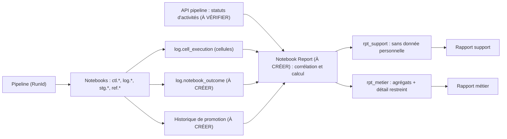

Written for : l'équipe support/exploitation, les interlocuteurs métier et la personne qui implémentera. Aucun fichier modifié, aucun traitement lancé. Les constats viennent du code de `TST_4` (module `compare`, `run_control`, `steps`, `spark_io`, `model`), des README et de l'historique du run du 08/10/2026 consulté plus tôt dans cette session.

---

# Conception — rapports de suivi et de présentation des deltas
**Processus** : hub RH TalentSoft PRD → Lakehouse → ADP (`T4_PL_HRIS_ORCHESTRATOR`, dossier `TEST_MOTUL/TST_4`)
**Statut du document** : conception, rien n'est implémenté. Tout exemple est **FICTIF**.

Légende des sources : **[EXISTANT]** observé dans le code · **[EXISTANT – NON DÉPLOYÉ]** dans le code mais jamais exécuté dans Fabric · **[À CRÉER]** · **[À VÉRIFIER]** non établi.

---

## 1. Synthèse du besoin et du périmètre

| Besoin | Public | Question centrale |
|---|---|---|
| **Rapport support** | support, exploitation | « Que s'est-il passé au dernier run, est-ce complet, que dois-je faire ? » |
| **Rapport métier** | RH, responsables métier | « Qu'est-ce qui a changé dans les données (ajouts, modifications, absences) ? » |
| Deux deltas métier **distincts** | idem | A : run courant vs run précédent · B : run courant vs dernier état du jour précédent |

**Périmètre** : le processus `TS_ADP_EMPLOYEE` (acquisition → transformation → comparaison → promotion → publication ADP verrouillée → clôture). Hors périmètre : notifications (D-NOT non décidés), flux SFTP de rémunération, publication ADP réelle.

**Trois constats structurants** (vérifiés dans le code) :

1. **Statut du pipeline ≠ statut du run.** Le 08/10/2026, les 7 activités étaient « Opération réussie » alors que le run était `BLOCKED` (extraction incomplète, correspondances vides, promotion non faite). Seule la table `ctl.run` dit la vérité métier. Un rapport basé sur le Monitor Fabric seul serait trompeur.
2. **Le delta actuel n'est pas un delta « run précédent ».** La comparaison existante se fait contre la **référence** `ref.ts_employee_adp`, c'est-à-dire l'état du **dernier run promu**. Elle égale « run précédent » seulement si ce dernier a été promu.
3. **La référence est écrasée à chaque promotion** (un seul `MERGE`, les absents sont supprimés). L'ancienne valeur d'un salarié modifié ou supprimé n'existe plus dans `ref` ; elle ne subsiste que dans les tables `stg.*` des runs antérieurs, dont aucune politique de rétention n'est définie.

---

## 2. Inventaire des sources

### 2.1 Disponibles

| Information | Source | Statut | Limites constatées |
|---|---|---|---|
| Identité du run : `run_id` (= RunId du pipeline), mode, `business_date`, `run_seq_in_day`, déclenchement, workspace, statut, `compared_against_run_id`, `promoted_at_utc`, début/fin, code et résumé d'erreur, `target_run_id` | `ctl.run` | EXISTANT | Pas d'`env_code` stocké (il n'existe que dans la sortie de RunEnd) ; pas de lien « rejeu de » ; statut intermédiaire tant que RunEnd/RunFail n'a pas tourné |
| Étapes : `step_code`, `attempt_no`, statut, `rows_in`, `rows_out`, `content_hash`, message JSON de compteurs, début/fin | `ctl.run_step` | EXISTANT | Codes : `ACQUIRE`, `TRANSFORM`, `COMPARE`, `PROMOTE`, `PROMOTE_WRITE` (marqueur), `PUBLISH_ADP`, `ACQUIRE_PREFLIGHT`. Écriture « append » : `STARTED` puis `SUCCEEDED`/`FAILED`/`SKIPPED`. **RunStart/RunEnd/RunFail n'écrivent aucune ligne.** Les sauts précoces (`SKIPPED_STATUS_…`, `SKIPPED_RETRY_PUBLICATION`, `SKIPPED_NOT_PROMOTED_…`) **ne laissent aucune ligne** |
| Contrôles qualité et anomalies (`PASS`/`FAIL`/`NOT_CONFIGURED`, sévérité `BLOCKING`/`WARNING`/`INFO`, métrique, seuil) | `log.anomaly` | EXISTANT | Un contrôle par run, rejoué par `replaceWhere` |
| Résumé historique du run | `log.run_summary` | EXISTANT | `mt_lignes_inserts` = NEW **+ MODIFIED** : ne pas l'afficher comme « ajouts » |
| Comparaison : compteurs, pourcentages, `is_first_load`, base utilisée | `log.comparison_summary` | EXISTANT | Calculée contre la référence, pas contre « le run précédent » |
| Comparaison détaillée : clé, catégorie, **noms** de colonnes modifiées, empreintes | `log.comparison_detail` | EXISTANT | `UNCHANGED` non journalisé ; aucune valeur ; contient la clé salarié (donnée à protéger) |
| Rejets par type et colonne | `stg.ts_employee_reject` (complet), `log.reject` (valeurs masquées) | EXISTANT | Contiennent des identifiants salariés |
| Données par run (acquises, transformées, format paie) | `stg.ts_employee_raw`, `_source`, `_enriched`, `_adp` | EXISTANT | Écrites par `replaceWhere run_id`, **jamais purgées par le code** ; `stg.ts_employee_adp` **exclut** les salariés rejetés du run |
| État courant | `ref.ts_employee_adp` | EXISTANT | Un seul état (écrasé) ; `_last_run_id`, `_validated_at_utc` par salarié |
| Publication | `pub.adp_outbox`, `log.adp_gate_decision` | EXISTANT | Aucun envoi réel en l'état : statut attendu `NOT_PUSHED_NON_PRD` |
| Verrou | `ctl.process_lock` | EXISTANT | Une seule ligne (état courant) |
| Cellules de code exécutées | `log.cell_execution` | **EXISTANT – NON DÉPLOYÉ** | Table à créer par `T4_NB_HRIS_SETUP` ; réussites optionnelles (`log_cell_success`) ; l'**absence** de ligne ne prouve rien |
| Détail de l'acquisition (compteurs par endpoint, périmètre `LegalStructure=Motul France`, mode extraction complète) | JSON dans `ctl.run_step.message` (étape `ACQUIRE`) | EXISTANT | À parser ; `total_count` TalentSoft vs lignes reçues |
| Hash des correspondances | `ctl.run_step.content_hash` (étape `TRANSFORM`) | EXISTANT | Permet de détecter un changement de correspondances entre runs |
| Historique Delta des tables | `DESCRIBE HISTORY`, `VERSION AS OF` | **[À VÉRIFIER]** | Durée de rétention réelle non établie (le README parle de 30 jours pour une restauration) |

### 2.2 Manquantes, avec l'instrumentation nécessaire

| Id | Manque | Conséquence | Complément proposé |
|---|---|---|---|
| I-01 | Environnement (`env_code`) et Lakehouse dans `ctl.run` | Environnement du run déduit du seul nom de workspace | Colonne ou table de contexte du run **[À CRÉER]** |
| I-02 | **Résultat fonctionnel de chaque notebook** (valeur de sortie : `ACQUIRED_INCOMPLETE`, `BLOCKED_MAPPINGS`, `SKIPPED_…`, `promoted:false`…) | Impossible de prouver un saut volontaire ou un blocage sans le Monitor | Table `log.notebook_outcome` écrite par la cellule de clôture, sortie assainie **[À CRÉER]** |
| I-03 | Statuts et durées **des activités du pipeline** (succès, échec, ignorée par dépendance, non démarrée) | Absents du Lakehouse ; l'historique du Monitor est limité dans le temps (durée **[À VÉRIFIER]**) | Collecte par l'API REST Fabric (requête d'exécutions d'activités) **[À VÉRIFIER]**, ou export planifié |
| I-04 | Lien activité ↔ cellules (RUN_CONTROL est appelé par 4 activités) | Cellules non rattachables à une activité | Paramètre constant `p_activity_name` par activité, copié dans le journal **[À CRÉER]** |
| I-05 | Version du code, empreinte des colonnes comparées, périmètre, par run | Impossible de juger la **comparabilité** de deux runs | Empreintes des modules de la bibliothèque (calculées au chargement, non persistées) + empreinte de `COMPARE_COLUMNS` **[À CRÉER]** |
| I-06 | **État de la référence après chaque promotion** | Delta B exact impossible ; delta A inexact si un salarié rejeté intervient | Table d'historique de promotion **[À CRÉER]** (§6.3) |
| I-07 | Politique de rétention des `stg.*`, de l'historique et des journaux | Risque de croissance non maîtrisée ou de purge sans avertissement | Décision + purge outillée **[À CONFIRMER]** |
| I-08 | Lien explicite « ce run rejoue tel run échoué » | Rejeu déduit seulement par proximité | Colonne optionnelle `retry_of_run_id` **[À CRÉER]** |
| I-09 | Plan **prévu** par mode (quelles étapes doivent s'exécuter) | Le « prévu » vit dans le code, pas en table | Table de référence statique `rpt.expected_step` **[À CRÉER]**, dérivée du code |
| I-10 | Libellés métier des colonnes + classe de sensibilité | Le métier lirait `cd_organisationalstructure_adp` | Table `rpt.column_label` validée par le métier **[À CRÉER]** |
| I-11 | `log.cell_execution` non déployée | Détail par cellule indisponible | Relancer `SETUP` après synchronisation |

---

## 3. Catalogue des rapports possibles

Priorité : **P1** = utile dès la première version · **P2** = après instrumentation · **P3** = enrichissement. Complexité : **F** faible · **M** moyenne · **E** élevée.

### 3.1 Support

| Id | Rapport | Questions | Sources | Faisabilité aujourd'hui | Compléments | Priorité / complexité |
|---|---|---|---|---|---|---|
| S1 | **Synthèse du dernier run** | Quel run, quel statut, complet ou non, quelle action ? | `ctl.run`, `log.anomaly`, `log.run_summary` | **Forte** (SQL sur l'existant) | I-01 pour l'environnement | **P1 / F** — répond à 80 % des appels ; données existantes |
| S2 | **Chronologie par activité / notebook / cellule** | Qu'a-t-on prévu, exécuté, réussi, ignoré ? | `ctl.run_step`, `log.cell_execution`, pipeline | **Partielle** : étapes oui, activités et sauts volontaires non | I-02, I-03, I-04, I-09, I-11 | **P1 (noyau) / M** — c'est ce qui évite les fausses conclusions |
| S3 | **Qualité et anomalies** | Quels contrôles ont échoué, lesquels sont bloquants, quels rejets ? | `log.anomaly`, `stg.ts_employee_reject` (comptes seulement) | Forte | — | **P1 / F** |
| S4 | **Comparaison technique avec le run précédent** | Durées, volumes, anomalies : dérive ? | `ctl.run`, `ctl.run_step`, `log.anomaly` | Forte (étapes), partielle (activités) | I-03 | **P2 / M** |
| S5 | **Verrou et runs non clôturés** | Un run est-il bloqué ou orphelin ? Le verrou a-t-il expiré ? | `ctl.process_lock`, `ctl.run` | Forte | — | **P1 / F** — cause fréquente de `SKIPPED_CONCURRENT` |
| S6 | **Publication ADP** | Décision du garde-fou, état de l'outbox ? | `log.adp_gate_decision`, `pub.adp_outbox`, `ctl.run` | Forte (le garde-fou ADP est verrouillé en l'état) | — | **P2 / F** |
| S7 | **Tendance des N derniers runs** | Durée, taux de rejet, anomalies récurrentes ? | `ctl.run`, `ctl.run_step`, `log.comparison_summary` | Forte | — | **P3 / F** |

### 3.2 Métier

| Id | Rapport | Questions | Sources | Faisabilité aujourd'hui | Compléments | Priorité / complexité |
|---|---|---|---|---|---|---|
| M1 | **Delta A : run courant vs run précédent** | Qu'est-ce qui a changé depuis le dernier run ? | `log.comparison_*`, `stg.ts_employee_adp` | **Partielle** : compteurs et clés oui ; valeurs anciennes et absents non | I-05, I-06, I-10 | **P1 (volumes) puis P2 (détail) / M** |
| M2 | **Delta B : run courant vs dernier état du jour précédent** | Qu'est-ce qui a changé depuis hier ? | snapshots par run | **Non faisable exactement** (référence écrasée) ; approximation par `stg` si conservés | I-06, I-07, règle C-04 | **P2 / E** |
| M3 | **Journal des changements d'une période** | Quels changements, dans quel ordre, par quel run ? | `log.comparison_detail` des runs **promus** | Forte pour les clés et noms de champs | Filtre « promus » | **P2 / M** |
| M4 | **Qualité des données (rejets par motif, correspondances)** | Pourquoi des salariés n'arrivent pas dans la paie ? | `stg.ts_employee_reject`, `log.anomaly` | Forte, **agrégée** | Libellés (I-10) | **P2 / F** |
| M5 | **Complétude de l'extraction** | A-t-on reçu tous les salariés de Motul France ? | JSON de `ACQUIRE`, `log.anomaly` | Forte | — | **P1 / F** — conditionne la validité des absences |

**Volontairement écarté** : consommation de capacité, coûts, surveillance des API TalentSoft au-delà du processus, audit d'accès : sans lien avec le périmètre documenté.

---

## 4. Rapport support — spécification

### 4.1 Principes

* **Trois statuts, jamais mélangés** : statut du pipeline (Monitor), statut du run (`ctl.run`), résultat fonctionnel du notebook (sortie). Chacun est affiché avec sa **source**.
* **Une valeur inférée est signalée** (« inféré »). Une étape sans trace est affichée **« Non tracé »**, jamais « Ignorée » ni « Réussie ».
* Les statuts réels sont conservés tels quels : run `STARTED, ACQUIRED, TRANSFORMED, VALIDATED, BLOCKED, PROMOTED, PUBLISHED, PUBLISHED_PARTIAL, NOT_PUBLISHED_NON_PRD, SUCCEEDED, FAILED, SKIPPED_CONCURRENT` ; étape `STARTED, SUCCEEDED, FAILED, SKIPPED`.
* La classification de synthèse ci-dessous est une **proposition**.

### 4.2 Trois sens de « ignoré » à distinguer

| Cas | Comment il se voit | Est-ce une erreur ? |
|---|---|---|
| **Activité du pipeline ignorée** par dépendance (une étape amont a échoué) | Activité « Skipped » dans le pipeline, aucune trace Lakehouse | Conséquence d'un échec amont |
| **Saut volontaire dans un notebook** (`SKIPPED_RETRY_PUBLICATION`, `SKIPPED_STATUS_…`, `SKIPPED_NOT_PROMOTED_…`, `SKIPPED_INIT_REFERENCE`) | Activité « réussie », sortie du notebook ; **aucune ligne** `ctl.run_step` sauf pour la promotion | Non |
| **Run non démarré** : verrou non obtenu | `ctl.run.status = SKIPPED_CONCURRENT`, aucune activité après RunStart | Non, sauf verrou orphelin |

### 4.3 Étapes prévues par mode (à stocker en `rpt.expected_step`, I-09)

| Étape | `NORMAL` | `INIT_REFERENCE` | `RETRY_PUBLICATION` |
|---|---|---|---|
| RunStart | oui | oui | oui |
| Acquire / Transform / Compare / Promote | oui | oui | **sautées volontairement** |
| Publish | oui (`NOT_PUBLISHED_NON_PRD` hors PRD) | **sautée volontairement** | oui, sur `target_run_id` |
| RunEnd / RunFail | RunEnd si Publish réussit, sinon RunFail | idem | idem |

### 4.4 Structure du rapport

1. **Bandeau** : run analysé, environnement, fraîcheur, périmètre.
2. **Synthèse** : classification proposée + action recommandée.
3. **Plan vs réalisé** par activité.
4. **Détail notebook et cellules**.
5. **Données traitées** (volumes).
6. **Qualité** (anomalies, rejets agrégés).
7. **Comparaison technique** avec le run précédent.
8. **Reprise** (possibilité, précautions).

**Classification proposée** : `OK` · `OK AVEC RÉSERVE` · `ACTION REQUISE` · `EN COURS` · `INDÉTERMINÉ`.

| Condition | Classe proposée |
|---|---|
| `ctl.run.status = SUCCEEDED` ou `NOT_PUBLISHED_NON_PRD`, aucune anomalie `BLOCKING`/`FAIL` | OK |
| idem avec avertissement (`WARNING` en échec, `NOT_CONFIGURED`) | OK AVEC RÉSERVE |
| `BLOCKED`, `FAILED`, `PUBLISHED_PARTIAL`, extraction incomplète | ACTION REQUISE |
| statut `STARTED/ACQUIRED/TRANSFORMED/VALIDATED/PROMOTED` et activité en cours ou fin récente | EN COURS |
| statut `STARTED` ancien (bail du verrou expiré) ou sources contradictoires ou manquantes | INDÉTERMINÉ |
| `SKIPPED_CONCURRENT` | OK si verrou tenu par un run actif ; ACTION REQUISE si verrou expiré |

### 4.5 Maquettes (FICTIVES)

**Bandeau et synthèse**

| Élément | Valeur (fictive) |
|---|---|
| Run analysé | `RUN-F2` · mode `NORMAL` · séquence du jour : 2 |
| Date métier / fuseau | 2099-03-14 / Europe/Paris |
| Environnement | workspace `WS-FICTIF-DEV` (déduit du workspace) |
| Statuts | pipeline : *Terminé* · run : **BLOCKED** · notebook Acquire : `ACQUIRED_INCOMPLETE` |
| Fraîcheur | rapport généré 2099-03-14 09:42 UTC · couvre les runs jusqu'à `RUN-F2` |
| **Classe proposée** | **ACTION REQUISE** |
| Pourquoi | extraction incomplète : 431 reçus pour 1 882 annoncés ; contrôle bloquant `TS_FILTER_TECHNICAL_FAILURE` ; référence **inchangée** |
| Action | relancer un nouveau run une fois l'API TalentSoft disponible ; ne pas forcer la promotion |

**Plan vs réalisé**

| Activité | Prévu | Statut pipeline *(source)* | Résultat fonctionnel *(source)* | Début | Durée | Lignes in → out | Motif / preuve |
|---|---|---|---|---|---|---|---|
| RunStart | oui | Réussie *(API)* | `OK` *(ctl.run)* | 09:00 | 4 min 46 | — | — |
| Acquire | oui | Réussie | `ACQUIRED_INCOMPLETE` *(notebook_outcome)* | 09:05 | 20 min 28 | 1 882 → 431 | `TS_FILTER_TECHNICAL_FAILURE` *(log.anomaly)* |
| Transform | oui | Réussie | `BLOCKED_MAPPINGS` | 09:26 | 5 min 11 | 431 → 0 | 13 correspondances vides |
| Compare | oui | Réussie | `BLOCKED` | 09:31 | 4 min 25 | — | `MAPPING_TABLE_EMPTY`, `REFERENCE_ABSENTE`, … |
| Promote | oui | Réussie | `promoted:false` · étape `SKIPPED` *(ctl.run_step)* | 09:36 | 4 min 55 | — | `STATUS_BLOCKED` |
| Publish | oui | Réussie | *Non tracé* (inféré : saut volontaire car run non promu) | 09:41 | 2 min 48 | — | **inféré** ; preuve directe disponible seulement avec I-02 |
| RunEnd | oui | Réussie | `BLOCKED` | 09:44 | 7 min 59 | — | verrou libéré |

**Détail des cellules** (source `log.cell_execution`, **[NON DÉPLOYÉ]**)

| Notebook | Cellule | Rang | Statut | Durée | Erreur (type / code / lieu) |
|---|---|---|---|---|---|
| T4_NB_HRIS_TS_ACQUIRE | CONFIG | 1 | SUCCEEDED | 2 s | — |
| T4_NB_HRIS_TS_ACQUIRE | PREFLIGHT | 2 | SUCCEEDED | 9 s | — |
| T4_NB_HRIS_TS_ACQUIRE | ACQUIRE | 3 | SUCCEEDED | 20 min | — |

Une cellule `SUCCEEDED` signifie « le code s'est terminé », pas « le processus a réussi » : le détail est donc toujours lu avec le résultat fonctionnel.

### 4.6 Tableau d'actions support (proposition, tirée des README et du code)

| Situation observable | Cause probable | Action support | Précaution |
|---|---|---|---|
| `SKIPPED_CONCURRENT` | un autre run actif | vérifier `ctl.process_lock` ; attendre la fin ou l'expiration du bail | **ne jamais supprimer la ligne de verrou** |
| `TS_SECRET_RESOLUTION` / `TS_SECRETS_UNAVAILABLE` | coffre inaccessible (B-01) | escalader au propriétaire d'accès | pas de relance en boucle |
| `EXTRACTION_INCOMPLETE`, `TS_FILTER_TECHNICAL_FAILURE`, `TS_ENDPOINT_FAILURE` | API TalentSoft indisponible ou instable | relancer un **nouveau** run | référence intacte, absences non confirmées |
| `MAPPING_TABLE_EMPTY` / `BLOCKED_MAPPINGS` | correspondances non fournies (B-02) | escalader au métier | relancer sans correspondances est inutile |
| `REFERENCE_ABSENTE` | premier chargement | décision métier : lancer `INIT_REFERENCE` | refusé si la référence n'est pas vide |
| `REFERENCE_MOVED`, `REVALIDATION_FAILED` | autre promotion intercalée, seuil modifié | relancer un nouveau run | ne pas forcer |
| `FAILED` avant `PROMOTE_WRITE` | erreur de traitement | lire `log.cell_execution` (lieu, type) puis relancer | référence intacte |
| `FAILED` **après** `PROMOTE_WRITE` | échec en cours de promotion | vérifier `promoted_at_utc`, `ref._last_run_id`, `pub.adp_outbox` **avant toute relance** | le recalcul du comparatif est interdit |
| `PUBLISHED_PARTIAL`, résultats `UNCERTAIN` | publication incomplète | `RETRY_PUBLICATION` avec `p_target_run_id`, après décision tracée | aucun renvoi automatique |
| `CONVERSION_ERROR` | donnée source invalide | escalader développement et métier | — |

### 4.7 Comparaison technique avec le run précédent (distincte du delta métier)

| Indicateur | Run courant | Run immédiatement précédent | Dernier run `SUCCEEDED` | Écart |
|---|---|---|---|---|
| Identifiant / mode / date | | | | |
| Statut final | | | | |
| Étapes exécutées (liste) | | | | étapes en plus / en moins |
| Durée par étape | | | | % |
| Volumes : reçus, rejetés, écrits | | | | % |
| Anomalies `FAIL` (codes) | | | | nouvelles / disparues |

**Règle** : le « précédent » et le « dernier réussi » sont **deux colonnes séparées**, jamais substituées l'une à l'autre. Si le précédent n'existe pas : « premier run, comparaison indisponible ».

### 4.8 Fréquence, accès, sensibilité

* **Mise à jour** : à la fin de chaque run (y compris en échec), plus un rafraîchissement des runs `EN COURS`. Date de fraîcheur toujours affichée.
* **Accès** : équipe support et développement. Contenu : identifiants techniques, compteurs, codes, messages assainis. **Aucun** identifiant salarié, valeur RH ni secret ; les liens vers `stg.*`/`ref.*` ne sont pas exposés.

---

## 5. Rapport métier et deux deltas — spécification

### 5.1 Principes

* Libellés métier (I-10), **aucun log technique**. Chaque comparaison affiche ses références (identifiants, dates, état) et sa **disponibilité** : `DISPONIBLE`, `PARTIELLE`, `INDISPONIBLE`, `À CONFIRMER`.
* **Clé métier** : `id_unique`. **Champs comparés** : les 71 colonnes de `COMPARE_COLUMNS` (les 72 colonnes ADP sans `dt_transforme`). **Égalité** : empreinte de ligne, `NULL` distinct de la chaîne vide ; liste des champs modifiés = colonnes différentes.
* **Catégories** (existantes) : `NEW`, `MODIFIED`, `UNCHANGED`, `ABSENT`, `REJECTED`.

| Libellé métier proposé | Catégorie technique | Règle |
|---|---|---|
| Ajouté | `NEW` | clé absente de l'état de base |
| Modifié (avec champs) | `MODIFIED` | empreinte différente |
| Inchangé | `UNCHANGED` | empreinte identique |
| **Absent de l'extraction** | `ABSENT` | présent dans la base, absent du courant |
| **Suppression confirmée** | *(calculée)* | absent **et** extraction complète **et** run validé **[À CONFIRMER, C-08]** |
| Non intégré (rejeté) | `REJECTED` | voir rapport qualité ; l'état de base reste inchangé |

**Garde-fou** : en cas d'extraction incomplète, de blocage ou de périmètre différent, les absents sont affichés « **absents de l'extraction — non confirmés** », jamais « supprimés ».

**Piège de libellé** : `log.run_summary.mt_lignes_inserts` = ajoutés **+ modifiés** ; on n'utilise pas ce champ pour « ajouts ».

### 5.2 Delta A — run courant vs run précédent

| Rubrique | Définition |
|---|---|
| Run courant | voir §6.1 |
| Run précédent | run immédiatement antérieur de même processus, ordre `(trigger_time_utc, run_id)`, de **même nature** (NORMAL/INIT) ; **jamais remplacé** par un plus ancien |
| État de comparaison | état **après promotion** du run (snapshot, I-06) ; si le précédent n'a pas été promu : `INDISPONIBLE` avec raison, plus une ligne séparée « dernier run promu » clairement étiquetée |
| Existant | `log.comparison_summary.compared_against_run_id` indique déjà la base utilisée par le pipeline ; elle est affichée pour détecter l'écart avec « précédent » |

**Maquette (FICTIVE)**

| Élément | Valeur |
|---|---|
| Run courant | `RUN-F3` — 2099-03-14, séquence 2, promu à 12:10 |
| Run précédent | `RUN-F2` — 2099-03-14, séquence 1, promu à 06:10 |
| Disponibilité | **DISPONIBLE** |
| Périmètre / règles | Motul France, extraction complète ; mêmes règles et mêmes 71 colonnes |

| Catégorie | Salariés | Évolution |
|---|---|---|
| Ajoutés | 4 | |
| Modifiés | 12 | dont 7 « Structure organisationnelle », 3 « Type de contrat », 2 autres |
| Absents (non confirmés) | 0 | |
| Inchangés | 1 866 | |
| Non intégrés (rejetés) | 3 | |

### 5.3 Delta B — run courant vs dernier état du jour précédent

**Question à trancher (C-04, À CONFIRMER)** : que signifie « dernière donnée du jour précédent » ? Trois lectures possibles, dont **aucune n'est documentée** :

| Option | Définition | Avantages / limites |
|---|---|---|
| **B1 — recommandée** | état après le **dernier run promu** dont `business_date = J-1` | cohérente avec la date métier déjà utilisée partout ; peut inclure un run lancé à 23:50 et promu à 00:10 |
| B2 | état de la référence à **23:59:59 (Paris) de J-1** (dernier `promoted_at_utc` ≤ minuit) | fidèle à « ce qui était en vigueur à minuit » ; exclut un run lancé J-1 et promu J |
| B3 | dernier run quelconque de J-1 | **déconseillée** : peut être échoué ou bloqué, donc sans état valide |
| B4 | date d'état présente dans les données | **non applicable** : aucune des 72 colonnes n'est une date d'état |

| Rubrique | Définition |
|---|---|
| Absence de run promu à J-1 | `INDISPONIBLE` « aucun état promu le 2099-03-13 » ; **pas de repli silencieux** vers J-2. Une ligne **séparée** peut afficher « dernier état disponible : 2099-03-11 (indicatif) » |
| Contenu | mêmes catégories que le delta A |

**Maquette (FICTIVE)**

| Élément | Valeur |
|---|---|
| Courant | `RUN-F3` (2099-03-14) |
| Base | dernier état promu du 2099-03-13 : `RUN-F1`, promu 18:30 — règle **B1 [À CONFIRMER]** |
| Disponibilité | **DISPONIBLE** |

| Catégorie | Salariés |
|---|---|
| Ajoutés depuis hier | 4 |
| Modifiés depuis hier | 12 |
| Absents (non confirmés) | 0 |

### 5.4 Delta net et journal des changements (deux rapports distincts)

| Rapport | Contenu | Exemple (FICTIF) |
|---|---|---|
| **Delta net** | différence entre **deux états** | le salarié `E-0007` ajouté au run 1 puis retiré au run 2 du même jour : **delta quotidien = 0** |
| **Journal des changements (M3)** | tous les changements de **chaque run promu** de la période, dans l'ordre | `RUN-1 : E-0007 Ajouté` puis `RUN-2 : E-0007 Absent` |
| Modification A→B→A | delta net = « inchangé » ; journal = 2 modifications | |

Le journal se construit à partir de `log.comparison_detail` **filtré sur les runs promus**. Un run `BLOCKED` n'a pas changé l'état : ses lignes sont « changements qui auraient été appliqués » et ne doivent pas figurer au journal.

### 5.5 Niveau de détail et accès

| Niveau | Contenu | Public |
|---|---|---|
| Synthèse | volumes, évolutions significatives, avertissements de comparabilité | métier |
| Détail | identifiant salarié, catégorie, champs modifiés avec libellés, attributs d'organisation | personnes autorisées **[À CONFIRMER, C-09]** |
| Valeurs sensibles | NIR, IBAN/BIC/compte, date de naissance, adresses, e-mails/téléphones personnels, salaire, prime | **masquées** : « champ sensible modifié » sans valeur |

Limite : la sécurité par rôles OneLake est **désactivée** sur ce Lakehouse (README) : l'accès se fait au niveau du workspace. Le détail doit donc être servi par un objet distinct (modèle sémantique avec sécurité par ligne, ou Lakehouse restreint), pas par les mêmes tables que le support.

---

## 6. Règles de référence, d'historisation et de comparaison

### 6.1 Décisions de référence (propositions)

| Sujet | Règle proposée | État |
|---|---|---|
| **Run courant** | par défaut : dernier run `NORMAL`/`INIT_REFERENCE` par `(trigger_time_utc, run_id)`, hors `SKIPPED_CONCURRENT` (listés à part) ; paramètre `run_id` pour consulter un autre run | À CONFIRMER (C-01) |
| Run `EN COURS` | affiché « en cours » avec fraîcheur ; aucun delta final | proposé |
| `RETRY_PUBLICATION` | run de publication seulement ; rattaché à `target_run_id` ; **exclu** de la séquence des runs de données | proposé |
| Run précédent vs dernier validé | deux notions **toujours affichées séparément** | décidé ici |
| Runs `FAILED`/`BLOCKED`/partiels/annulés | pas d'état de référence ; delta éventuel marqué « indicatif, non appliqué » | proposé |
| Rejeu | un nouveau déclenchement = nouveau `run_id` ; l'ancien reste `FAILED` ; lien optionnel `retry_of_run_id` (I-08) | proposé |
| Journée métier | date de **déclenchement** en Europe/Paris (`business_date`, D-RUN-02) | À CONFIRMER (C-03) |
| Journée sans run / sans donnée | comparaison `INDISPONIBLE` explicite ; jamais de repli silencieux | décidé ici |
| Concurrence | verrou applicatif ; ordre de sélection **déterministe** `(promoted_at_utc, run_id)` (le code actuel trie par `promoted_at_utc` seul) | À CONFIRMER (C-06) |
| Cohérence entre tables | un état = **un run promu** : `ref` (snapshot), `log.comparison_*`, `ctl.run` lus avec le **même `run_id`** | proposé |
| **Comparabilité** | deux runs sont comparables si **même périmètre**, **même empreinte de colonnes**, **même version de règles**, **mêmes correspondances** ; sinon `PARTIELLE` avec cause | proposé (I-05) |

**Comparabilité — sources** : périmètre `LegalStructure=Motul France` et mode « extraction complète » (JSON de l'étape `ACQUIRE`) **[EXISTANT]** · hash des correspondances (`content_hash` de `TRANSFORM`) **[EXISTANT]** · empreinte des colonnes et des modules **[À CRÉER]**. Un changement de règle ou de correspondance fait apparaître des « modifications » **sans changement de donnée source** : le rapport doit l'indiquer.

### 6.2 Disponibilité d'une comparaison

| État | Condition | Affichage |
|---|---|---|
| `DISPONIBLE` | deux états promus, comparables, extraction complète | chiffres |
| `PARTIELLE` | comparabilité douteuse (règles, correspondances, colonnes différentes), ou salarié rejeté dans la base ou le courant | chiffres + avertissement + cause |
| `INDISPONIBLE` | base absente, non promue, premier run | raison explicite |
| `À CONFIRMER` | règle de référence non validée (C-04) | chiffres + mention « règle à confirmer » |

### 6.3 Conservation des états

| Option | Principe | Exactitude | Coût / risque |
|---|---|---|---|
| **A — s'appuyer sur `stg.ts_employee_adp` par run** | états déjà présents | **Inexacte** si un salarié est rejeté (exclu de `stg` mais conservé dans `ref`) ; dépend d'une rétention non définie | aucun développement ; fragile |
| **B — historique de promotion (recommandée)** | à chaque promotion, **copie de l'état `ref`** dans une table d'historique (`run_id`, `business_date`, `promoted_at_utc`, clé, empreinte, colonnes) | **Exacte** : delta = différence de deux états promus | ordre de grandeur : ~2 000 lignes × 72 colonnes par run promu (à confirmer) ; **données personnelles** donc table restreinte ; purge à définir |
| C — voyage dans le temps Delta (`VERSION AS OF` à `promoted_at_utc`) | aucune copie | exacte **si** l'historique est conservé | rétention réelle **[À VÉRIFIER]** ; fragile face à `VACUUM`/maintenance ; mauvaise base pour un rapport durable |
| D — journal de changements seul | compteurs et clés | **insuffisant** : pas de valeurs, ne reconstruit pas l'état | — |

**Contrainte de placement pour B** : la copie doit être faite **tant que le verrou est tenu** (avant RunEnd), sinon un autre run pourrait déjà avoir modifié `ref`. Elle ne doit **jamais** faire échouer le run (étape tolérante, erreur journalisée).

**Option atténuée** : au lieu des valeurs, stocker clé + empreinte globale + empreinte par colonne : permet de lister les champs modifiés sans conserver de valeur. À arbitrer avec la sécurité (C-09).

**Ce qu'il faut garder avant écrasement** : l'état complet de `ref` après chaque promotion (clé, empreinte, colonnes comparables). Sans cela, les anciennes valeurs d'un salarié modifié ou supprimé sont perdues dès la promotion suivante. Les compteurs et les logs d'exécution **ne suffisent pas** à reconstruire les changements métier.

---

## 7. Solution recommandée et plan de mise en œuvre

### 7.1 Flux d'information

Découpage : **collecte et corrélation** (instrumentation I-01 à I-05) · **conservation** (historique de promotion) · **calcul** (notebook `Report`) · **restitution support** · **restitution métier**.

### 7.2 Modes de présentation

| Mode | Atouts | Limites | Verdict |
|---|---|---|---|
| Requêtes SQL sur les tables existantes | immédiat, aucun développement | lecture technique, pas de corrélation de l'activité | **Étape 0** |
| Tables `rpt.*` matérialisées + vues SQL | simple, testable, source commune aux autres modes | création des vues sur le point de terminaison SQL **[À VÉRIFIER]** | **V1 (socle)** |
| Rapport généré (HTML/Markdown) écrit par le notebook dans le Lakehouse | aucun outil supplémentaire, instantané du run, archivable | lecture par fichier, peu interactif | **V1 (support)** |
| Rapport Power BI (modèle sémantique sur Lakehouse) | filtres, tendances, **sécurité par ligne**, public métier | licences et capacité **[À CONFIRMER]** ; cycle de vie à gérer | **V2 (métier)** |
| E-mail / notification | proactif | **bloqué** (D-NOT-01/02 non décidés) | plus tard |
| Export Excel | usage ponctuel | pas de sécurité, copie incontrôlée de données RH | déconseillé |

**Recommandation** : V1 = tables `rpt.*` + rapport HTML support par run + synthèse métier agrégée sans détail salarié. V2 = historique de promotion, deltas A et B, modèle sémantique avec sécurité par ligne pour le métier. V3 = tendances, notifications.

### 7.3 Plan progressif

| Phase | Contenu | Livrable | Dépend de |
|---|---|---|---|
| **0 — sans développement** | requêtes de consultation `ctl.run`, `ctl.run_step`, `log.anomaly`, `log.comparison_summary` ; déployer `log.cell_execution` (I-11) | requêtes validées par le support | synchronisation Git, B-01 levé |
| **1 — instrumentation** | I-01, I-02, I-04, I-05, I-09 ; collecte des statuts de pipeline (I-03) | tables `rpt_support.*`, rapport support HTML | décisions C-01, C-02 |
| **2 — états et deltas** | I-06 (historique de promotion), I-07, I-10 ; delta A puis B ; journal des changements | `rpt_metier.*`, rapport métier agrégé | décisions C-03, C-04, C-08, C-09 |
| **3 — restitution durable** | modèle sémantique, sécurité par ligne, tendances | rapports interactifs | capacité Power BI |
| **4 — alertes** | notification | — | D-NOT-01/02 |

Chaque modification de notebook ou de pipeline existant suit les règles du dépôt (documentation Markdown, tests, non-régression du process 1) et reste **validée dans Fabric** avant d'être considérée acquise.

---

## 8. Tests et critères d'acceptation

Les calculs (sélection des références, classification, deltas) se testent **en local sur des jeux fictifs**, les écritures sur schéma isolé dans Fabric. Un test local ne remplace pas un test Fabric.

| Id | Scénario | Résultat attendu |
|---|---|---|
| T-01 | **Premier run**, référence absente, `NORMAL` | delta `INDISPONIBLE (premier chargement)` ; `REFERENCE_ABSENTE` expliqué ; aucune comparaison inventée |
| T-02 | Premier run `INIT_REFERENCE` | état initial créé, **aucun delta**, publication « saut volontaire » prévue |
| T-03 | **Plusieurs runs le même jour** | séquence respectée ; delta A = run précédent du jour ; delta B inchangé sur la même base J-1 |
| T-04 | **Aucun run la veille** | delta B `INDISPONIBLE` ; aucun repli sur J-2 ; ligne indicative séparée, étiquetée |
| T-05 | Veille avec un run **échoué ou bloqué** uniquement | pas de base promue ; `INDISPONIBLE` avec raison |
| T-06 | **Extraction partielle** (`EXTRACTION_INCOMPLETE`) | « absents non confirmés » ; aucune suppression affichée ; classe `ACTION REQUISE` |
| T-07 | Run **échoué** après `PROMOTE_WRITE` | statut explicite, action « vérifier avant relance » ; état de référence non remplacé silencieusement |
| T-08 | **Saut volontaire** (`RETRY_PUBLICATION`, `INIT_REFERENCE`) | affiché « ignoré volontairement » avec preuve ; **jamais** déduit de l'absence de logs |
| T-09 | **Absence de trace** (aucune ligne d'étape ni de cellule) | « Non tracé » ; ni « ignorée » ni « réussie » |
| T-10 | Journal de cellules **indisponible** (écriture échouée) | rapport signale la limite de traçabilité |
| T-11 | **Rejeu** du pipeline après échec | nouveau `run_id` ; ancien run conservé `FAILED` ; lien affiché si I-08 |
| T-12 | **Deux runs concurrents** | `SKIPPED_CONCURRENT` listé à part ; sélection déterministe ; aucune référence ambiguë |
| T-13 | **Ajouts, modifications, absences** sur jeu fictif de 20 salariés | compteurs et champs exacts, égaux au pipeline pour la même base |
| T-14 | Salarié **rejeté** dans le courant (présent dans la base) | catégorie « non intégré » ; état de base inchangé ; pas de fausse « modification » |
| T-15 | **Changement de schéma** ou de colonnes comparées | comparaison `PARTIELLE`, cause affichée |
| T-16 | **Changement de règle ou de correspondance** | idem ; mention « changement possible sans variation de la source » |
| T-17 | **Périmètre différent** | `PARTIELLE` ou `INDISPONIBLE` |
| T-18 | **Delta inter-run ≠ delta quotidien** : ajout au run 1, retrait au run 2 | delta A (run 2 vs run 1) = 1 absent ; delta B = 0 ; journal = 2 lignes |
| T-19 | Modification A→B→A | delta B « inchangé » ; journal : 2 modifications |
| T-20 | Run lancé 23:50 J-1, promu 00:10 J | règle **C-04** appliquée, base et heure affichées |
| T-21 | **Aucun secret ni donnée RH** dans les tables et rapports support | contrôle automatisé de motifs et de colonnes |
| T-22 | Contrôle d'accès : support sans accès au détail salarié | refus ; synthèse accessible |
| T-23 | Fraîcheur et périmètre | date de génération et runs couverts toujours présents |
| T-24 | Aucune dégradation du process 1 | sorties identiques avant/après instrumentation ; échec du reporting **sans effet** sur le run |

**Critères d'acceptation**
1. Tout statut affiché est **traçable à sa source** ; toute valeur inférée est étiquetée.
2. Aucune comparaison n'utilise silencieusement une autre référence que celle annoncée.
3. Les deux deltas sont identifiés séparément, avec références et limites.
4. Un jeu fictif connu produit exactement les compteurs attendus (T-13, T-18).
5. Le rapport support contient la classification, l'action et la fraîcheur pour tous les cas T-01 à T-12.
6. Aucune donnée personnelle dans les objets du support ; sensibles masquées côté métier.
7. Le reporting n'allonge pas significativement le run (mesure dans Fabric) et ne peut pas le faire échouer.

---

## 9. Décisions et informations `À CONFIRMER`

| Id | Sujet | Proposition | Qui décide |
|---|---|---|---|
| C-01 | Définition du **run courant** par défaut | dernier run de données hors `SKIPPED_CONCURRENT` | support + développement |
| C-02 | Classes de synthèse support (`OK`, `ACTION REQUISE`…) | §4.4 | support |
| C-03 | Fuseau et **journée métier** (déclenchement, Europe/Paris) | conserver `business_date` | métier |
| C-04 | « **Dernière donnée du jour précédent** » | B1 (dernier run promu de J-1) ; alternative B2 (état à minuit) | **métier** — aucune règle documentée |
| C-05 | Comparaison au **run précédent** quand il n'a pas été promu | `INDISPONIBLE` + ligne « dernier promu » séparée | métier |
| C-06 | Tri déterministe des références (`promoted_at_utc`, puis `run_id`) | oui | développement |
| C-07 | Seuils d'alerte (absents, modifiés, rejetés) — non configurés aujourd'hui | à fournir ; sinon aucun seuil inventé | métier |
| C-08 | **« Suppression confirmée »** : un absent d'une extraction complète est-il supprimé ? un cycle ou deux ? | un cycle validé, à confirmer | métier |
| C-09 | **Droits et champs visibles** : qui voit le détail salarié, quels attributs d'organisation, quelles valeurs masquées | §5.5 | métier + sécurité |
| C-10 | **Rétention** des `stg.*`, de l'historique de promotion, des journaux | à fixer (durée, purge) | exploitation + sécurité |
| C-11 | Clé `id_unique` et liste des 71 colonnes comparées | déjà « À CONFIRMER » (D-CMP-01) | métier |
| C-12 | Mode de présentation métier (Power BI ou autre), capacité, licences | V2 : modèle sémantique | métier + IT |
| C-13 | Collecte des statuts d'activités par API REST Fabric, droits nécessaires | à vérifier | développement |
| C-14 | `activityId` du contexte = identifiant d'exécution du notebook dans le Monitor ? | à vérifier avant de s'en servir pour corréler | développement |
| C-15 | Durée de rétention réelle de l'historique Delta et du Monitor | à mesurer | exploitation |
| C-16 | Vues SQL sur le point de terminaison du Lakehouse et leur droit de création | à vérifier | développement |
| C-17 | Rapports `RETRY_PUBLICATION` : présentation dédiée ou intégrée au run cible | intégrée, avec mention | support |

**Rappel** : rien de ce document n'est implémenté. Les tables `rpt.*`, `log.notebook_outcome` et l'historique de promotion sont des **propositions**. `log.cell_execution` existe dans le code mais n'a jamais été créée ni alimentée dans Fabric.