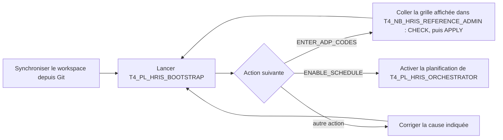
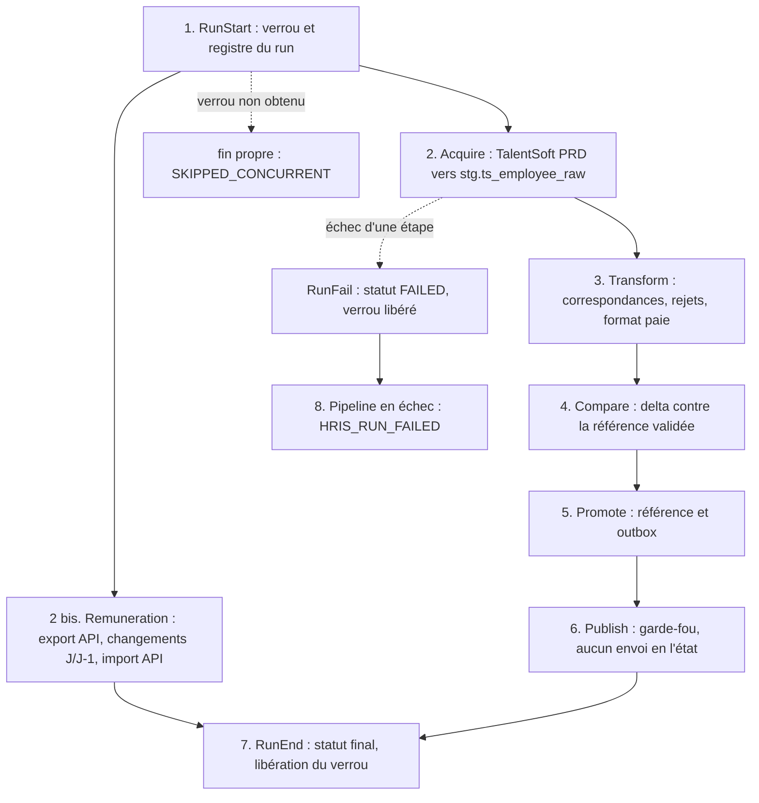

# Hub RH TalentSoft PRD → Lakehouse (puis ADP) sur Microsoft Fabric — vue d'ensemble

Ce dossier contient la deuxième version Fabric du hub d'intégration RH de Motul. À chaque exécution, le hub extrait
les données des salariés depuis **TalentSoft PRD**, applique les règles de transformation de l'existant (Synapse),
contrôle leur qualité, compare le résultat à l'état validé précédent, le conserve dans un Lakehouse et prépare ce qui
devra être publié vers la paie **ADP**. En parallèle, il reproduit le flux de rémunération TalentSoft → TalentSoft de
l'existant, par API et sans fichier. La publication vers ADP est **verrouillée** : elle n'est ni activée ni exécutée
dans cette version.

Ce document donne la vue **macro**. Le détail est rangé avec les objets qu'il décrit, dans le `README_DETAILS.md` de
chaque dossier.

## Organisation du dossier

| Dossier | Contenu | Quand | Détail |
|---|---|---|---|
| [`QUOTIDIEN/`](QUOTIDIEN/) | le pipeline quotidien `T4_PL_HRIS_ORCHESTRATOR`, ses 7 notebooks d'étape, la bibliothèque commune `T4_NB_HRIS_LIB`, la variable library `T4_VL_HRIS` | chaque jour à 06:00 (heure de Paris), automatiquement | [README_DETAILS](QUOTIDIEN/README_DETAILS.md) |
| [`ONESHOT/`](ONESHOT/) | le pipeline de premier chargement `T4_PL_HRIS_BOOTSTRAP` et son notebook, l'installation `T4_NB_HRIS_SETUP`, la saisie des codes ADP `T4_NB_HRIS_REFERENCE_ADMIN` | à la main : mise en service, évolution du modèle, nouveaux codes TalentSoft | [README_DETAILS](ONESHOT/README_DETAILS.md) |
| [`TESTS/`](TESTS/) | le notebook de tests `T4_NB_HRIS_TESTS` (données fictives, schéma isolé) | avant une mise en service ou après une modification ; appelé aussi par le premier chargement | [README_DETAILS](TESTS/README_DETAILS.md) |

À la synchronisation Git, ces dossiers deviennent des dossiers du workspace. **Seul le pipeline quotidien est
planifié** ; le pipeline de premier chargement n'a aucune planification. `PBI.md` est la conception, non implémentée,
des rapports de suivi.

## Mise en route : une action, puis la planification

1. **Synchroniser** le workspace depuis Git. La planification du pipeline quotidien reste **désactivée** pendant
   toute la mise en route. En DEV, tant que le coffre TalentSoft est illisible (B-01), passer `remuneration_enabled` à
   `false` dans `T4_VL_HRIS`.
2. **Lancer `T4_PL_HRIS_BOOTSTRAP`** à la main. Il installe le socle, lance les tests sur données fictives, exécute un
   run complet du pipeline quotidien dans le bon mode (`INIT_REFERENCE` si la référence est vide, sinon `NORMAL`),
   puis lit le résultat dans le Lakehouse et donne **une** action suivante.
3. **Au premier passage**, le run s'arrête normalement sur les codes ADP manquants (`ENTER_ADP_CODES`). La sortie de
   l'activité `Status` contient la grille à remplir : la coller, remplie, dans `T4_NB_HRIS_REFERENCE_ADMIN` (`CHECK`,
   puis `APPLY`), puis **relancer** le premier chargement, qui est rejouable sans risque.
4. Quand il se termine avec succès (`ENABLE_SCHEDULE`), **activer la planification** du pipeline quotidien.

[→ Détail du premier chargement](ONESHOT/README_DETAILS.md#premier-chargement) ·
[saisie des codes ADP](ONESHOT/README_DETAILS.md#codes-adp)

## État d'avancement en un coup d'œil

| Niveau | État | Preuve |
|---|---|---|
| Code écrit et testé localement | **Fait** : 150 tests unitaires, 142 réussis en local, 8 ignorés hors Fabric (Spark, schéma de test, document de référence absent) ; non-régression ADP et parité Spark établies lors des campagnes T3 | [Tests](TESTS/README_DETAILS.md#tests) |
| Tests dans Fabric sur données fictives | **Fait en version T3** : 71 tests, 0 échec, sans Lakehouse par défaut ; à relancer sur `TST_4` (le premier chargement le fait) | [Tests](TESTS/README_DETAILS.md#tests) |
| Extraction réelle TalentSoft PRD | **Exécutée** (version T3 le 08/10/2026, puis `TST_4`), avec la règle de population de l'existant. Les identifiants TalentSoft sont **écrits dans le code** de l'acquisition, contournement temporaire de B-01 | [Acquisition](QUOTIDIEN/README_DETAILS.md#acquisition) |
| Transformation, comparaison, référence sur données réelles | **Bloquées** tant que les codes ADP ne sont pas saisis (`MAPPING_TABLE_EMPTY`) | [Correspondances](QUOTIDIEN/README_DETAILS.md#correspondances) |
| Correspondances sans fichier | **Code écrit et testé en local** : partie TalentSoft par l'API, codes ADP saisis par grille collée (reprise possible des tables de l'existant) ; jamais exécuté dans Fabric | [Codes ADP](ONESHOT/README_DETAILS.md#codes-adp) |
| Premier chargement guidé | **Code écrit et testé en local** : 8 tests, 13 mutations détectées, simulation du notebook, contrôle statique des deux pipelines ; jamais exécuté dans Fabric | [Premier chargement](ONESHOT/README_DETAILS.md#premier-chargement) |
| Rangement en trois dossiers | **Fait dans le dépôt** ; le chargement de la bibliothèque par `%run` d'un dossier à l'autre est à vérifier au premier lancement | [Git et Fabric](ONESHOT/README_DETAILS.md#git) |
| Flux rémunération (ex-SFTP) | **Code écrit et testé en local** : export et import TalentSoft par API ; envoi désactivé tant que la structure n'est pas validée (mode `VALIDATE`) | [Rémunération](QUOTIDIEN/README_DETAILS.md#remuneration) |
| Publication ADP | **Verrouillée dans le code**, comme l'activité ADP de l'existant (désactivée) ; authentification câblée ; jamais exécutée ; contrat final absent | [Publication](QUOTIDIEN/README_DETAILS.md#publication) |
| Planification | **Quotidienne à 06:00** (heure de Paris), sur le seul pipeline quotidien ; **désactivée** dans le workspace jusqu'à la fin du premier chargement | [Lancement](QUOTIDIEN/README_DETAILS.md#lancement) |
| Synchronisation Git ↔ Fabric | rangement, premier chargement et grille : **changements locaux à commiter**, puis mise à jour du workspace | [Git et Fabric](ONESHOT/README_DETAILS.md#git) |

Ne pas confondre : *code écrit* ≠ *objet créé* ≠ *pipeline exécutable* ≠ *acquisition réelle* ≠ *traitement validé* ≠
*publication autorisée*.

## Le déroulement d'un run quotidien

1. **Ouverture.** Le run reçoit l'identifiant du pipeline, une date métier (Paris) et un verrou : un seul run actif à
   la fois. [→ Détail](QUOTIDIEN/README_DETAILS.md#run-control)
2. **Acquisition.** Extraction complète des salariés de « Motul France » depuis TalentSoft PRD, avec contrôle que
   tout a bien été reçu ; les codes et libellés des référentiels TalentSoft sont recopiés dans les tables de
   correspondance. En parallèle, **le flux rémunération** relit salaires et bonus par l'API, calcule les changements
   et les réimporte dans TalentSoft par l'API. [→ Acquisition](QUOTIDIEN/README_DETAILS.md#acquisition) ·
   [Rémunération](QUOTIDIEN/README_DETAILS.md#remuneration)
3. **Transformation.** Les règles de l'existant sont reproduites ligne à ligne ; les salariés non conformes sont
   rejetés avec leur motif. [→ Détail](QUOTIDIEN/README_DETAILS.md#transformation)
4. **Comparaison.** Le résultat est comparé à l'état validé précédent : nouveaux, modifiés, inchangés, absents,
   rejetés. [→ Détail](QUOTIDIEN/README_DETAILS.md#comparaison)
5. **Promotion.** Si aucun contrôle bloquant n'échoue, la référence est mise à jour et la liste à publier est figée.
   [→ Détail](QUOTIDIEN/README_DETAILS.md#promotion)
6. **Publication.** Le notebook évalue si le workspace d'exécution l'autorise ; même alors, l'envoi reste verrouillé.
   [→ Détail](QUOTIDIEN/README_DETAILS.md#publication)
7. **Clôture.** Le statut final est calculé et le verrou libéré ; aucune notification n'est envoyée à ce stade.
8. **Échec.** Un gestionnaire d'erreur unique déclare le run en échec, libère le verrou et termine le pipeline en
   erreur. Attention : un run **bloqué** (`BLOCKED`) laisse le pipeline en succès ; seule la table `ctl.run` donne le
   statut métier, ce que lit le premier chargement.

## Les objets Fabric

| Dossier | Objet | Rôle en une phrase |
|---|---|---|
| `QUOTIDIEN` | `T4_PL_HRIS_ORCHESTRATOR` | le pipeline quotidien : enchaîne les étapes d'un run et gère les échecs ; seul pipeline planifié |
| `QUOTIDIEN` | `T4_VL_HRIS` | les paramètres de l'environnement, sans secret : source TalentSoft, coffres, Lakehouse, options |
| `QUOTIDIEN` | `T4_NB_HRIS_LIB` | la bibliothèque commune, copie unique, chargée par `%run T4_NB_HRIS_LIB` dans chaque notebook |
| `QUOTIDIEN` | `T4_NB_HRIS_RUN_CONTROL` | ouvre un run (verrou, registre), le clôture ou le déclare en échec |
| `QUOTIDIEN` | `T4_NB_HRIS_TS_ACQUIRE` | extrait les salariés de TalentSoft PRD, contrôle la complétude, met à jour la partie TalentSoft des correspondances |
| `QUOTIDIEN` | `T4_NB_HRIS_REMUNERATION` | flux rémunération de l'existant (ex-SFTP), par API et en tables |
| `QUOTIDIEN` | `T4_NB_HRIS_TRANSFORM` | reprend les règles SQL de production : correspondances, rejets, format paie |
| `QUOTIDIEN` | `T4_NB_HRIS_COMPARE` | compare à la référence du dernier run validé et décide `VALIDATED` ou `BLOCKED` |
| `QUOTIDIEN` | `T4_NB_HRIS_PROMOTE` | met à jour la référence et prépare l'outbox |
| `QUOTIDIEN` | `T4_NB_HRIS_PUBLISH_ADP` | publication ADP : garde-fou sur le workspace d'exécution, activation verrouillée |
| `ONESHOT` | `T4_PL_HRIS_BOOTSTRAP` | premier chargement guidé : installation, tests, run du pipeline quotidien dans le bon mode, action suivante |
| `ONESHOT` | `T4_NB_HRIS_BOOTSTRAP` | les deux décisions du premier chargement : mode du run, action suivante |
| `ONESHOT` | `T4_NB_HRIS_SETUP` | crée, de façon idempotente, les schémas et les 48 tables |
| `ONESHOT` | `T4_NB_HRIS_REFERENCE_ADMIN` | saisie des codes ADP par grille collée, toutes les tables en une fois |
| `TESTS` | `T4_NB_HRIS_TESTS` | tests sur données fictives, dans un schéma isolé |
| `TEST_1` | `MOTUL_LH_HRIS` | le Lakehouse : toutes les tables de données, de contrôle et de log |

Les mêmes objets, avec le même code, sont prévus pour tous les environnements ; seuls les paramètres de `T4_VL_HRIS`
changeraient. Hors DEV, rien n'est déployé à ce jour. [→ Architecture](QUOTIDIEN/README_DETAILS.md#architecture)

## Les règles à retenir

- **La source est toujours TalentSoft PRD**, même depuis un workspace non-PRD ; les données fictives ne servent qu'aux
  tests isolés. [→ Détail](QUOTIDIEN/README_DETAILS.md#acquisition)
- **Aucune publication ADP réelle.** Le garde-fou lit le nom *réel* du workspace ; l'envoi est en plus verrouillé dans
  le code tant que le contrat final n'est pas validé. [→ Détail](QUOTIDIEN/README_DETAILS.md#publication)
- **Aucun fichier CSV.** Les correspondances TalentSoft → ADP sont des tables du Lakehouse : codes TalentSoft par
  l'API à chaque run, codes ADP saisis dans ces tables. [→ Détail](QUOTIDIEN/README_DETAILS.md#correspondances)
- **Un seul pipeline planifié**, le quotidien. Le premier chargement se lance à la main et se rejoue sans risque.
  [→ Détail](ONESHOT/README_DETAILS.md#premier-chargement)
- **Aucune donnée RH en clair** dans les paramètres, journaux ou rapports : compteurs, noms de colonnes et empreintes
  seulement. Exception temporaire à corriger : les identifiants TalentSoft dans le code de l'acquisition.
  [→ Détail](QUOTIDIEN/README_DETAILS.md#securite)
- **Rien n'est fait deux fois, rien n'est écrasé** sans validation distincte ; un résultat incertain n'est jamais
  renvoyé automatiquement. [→ Détail](QUOTIDIEN/README_DETAILS.md#exploitation)
- **Aucun Lakehouse par défaut à attacher** : les tables sont adressées par leur nom complet (workspace, Lakehouse,
  schéma, table). [→ Détail](QUOTIDIEN/README_DETAILS.md#architecture)
- **Chaque cellule de traitement est tracée** dans `log.cell_execution`. [→ Détail](QUOTIDIEN/README_DETAILS.md#journal-cellules)

## Blocages, décisions et prochaines étapes

| Réf. | Blocage | Constat | Action précise |
|---|---|---|---|
| B-01 | Secrets TalentSoft PRD inaccessibles depuis le workspace | `AKV10032 Invalid issuer` : coffre d'un autre tenant ; l'acquisition le contourne par des identifiants dans son code, le flux rémunération échoue | environnement Fabric de Motul (ou accès inter-tenant validé), puis retrait des identifiants du code et renouvellement |
| B-02 | Codes ADP des correspondances absents | TalentSoft ne stocke aucun code ADP (mesuré) ; la partie TalentSoft est alimentée par l'API | premier chargement : grille affichée par l'activité `Status`, saisie dans `T4_NB_HRIS_REFERENCE_ADMIN`, reprise possible des tables `dwh.lu_hr_*` de l'existant ([détail](ONESHOT/README_DETAILS.md#codes-adp)) |
| B-03 | Contrat final de publication absent | 17 points d'usage recensés | fournir le contrat ; appliquer point par point ; lever le verrou d'activation en dernier |
| B-04 | Notifications | mécanisme et destinataires non décidés | décider ; aucun envoi à ce jour |
| D-FIL-01 | Flux rémunération (CSV SFTP) | **levé** : export et import par API, tables seulement | valider la structure (`VALIDATE`), puis `ts_remuneration_import_enabled = true` en PRD |
| G-01 | Synchronisation du rangement | trois dossiers et deux nouveaux items dans le dépôt, non commités | commit, push, mise à jour du workspace ; vérifier le `%run` d'un dossier à l'autre au premier lancement |

**Décisions à rendre avant toute activation d'ADP** : convention de nommage des workspaces (`PREPRD`, `NOTPRD`,
`prd`), identité d'exécution, seuils d'anomalie, isolement des erreurs par salarié, liste blanche d'adresses IP chez
ADP, politique des lectures ADP. **Valeurs par défaut appliquées, non validées** : clé `id_unique`, 71 colonnes
comparées, absents supprimés de la référence, rejetés conservés, fuseau de Paris, bail de 240 minutes, trois tentatives
maximales.

**Prochaines étapes, dans l'ordre.**

1. Commiter, pousser et mettre à jour le workspace depuis Git.
2. Lancer `T4_PL_HRIS_BOOTSTRAP` ; saisir les codes ADP depuis la grille affichée ; le relancer jusqu'à
   `ENABLE_SCHEDULE`.
3. Activer la planification de `T4_PL_HRIS_ORCHESTRATOR`.
4. Revoir avec le métier les volumes, les rejets et la parité sur données réelles ; valider la structure du flux
   rémunération (`VALIDATE`).
5. Lever B-01 dans l'environnement Fabric de Motul ; retirer les identifiants du code.
6. Déploiement vers UAT et PRD, après validation distincte ; contrat ADP puis activation, **indépendamment** du reste.

## Plan de présentation (60 minutes)

| Durée | Sujet | Détail |
|---|---|---|
| 0-5 min | Contexte, objectifs, ce qui change par rapport à l'existant | [Contexte](QUOTIDIEN/README_DETAILS.md#contexte) |
| 5-12 min | Organisation, architecture et déroulement d'un run | [Organisation](#organisation) · [Architecture](QUOTIDIEN/README_DETAILS.md#architecture) |
| 12-22 min | Acquisition TalentSoft PRD et correspondances | [Acquisition](QUOTIDIEN/README_DETAILS.md#acquisition) · [Correspondances](QUOTIDIEN/README_DETAILS.md#correspondances) |
| 22-30 min | Transformation et qualité | [Transformation](QUOTIDIEN/README_DETAILS.md#transformation) |
| 30-37 min | Comparaison, promotion, outbox ; flux rémunération | [Comparaison](QUOTIDIEN/README_DETAILS.md#comparaison) · [Promotion](QUOTIDIEN/README_DETAILS.md#promotion) · [Rémunération](QUOTIDIEN/README_DETAILS.md#remuneration) |
| 37-45 min | Publication ADP et garde-fou | [Publication](QUOTIDIEN/README_DETAILS.md#publication) |
| 45-52 min | Mise en route : premier chargement et codes ADP | [Premier chargement](ONESHOT/README_DETAILS.md#premier-chargement) · [Codes ADP](ONESHOT/README_DETAILS.md#codes-adp) |
| 52-57 min | Preuves, démonstration, exploitation | [Tests](TESTS/README_DETAILS.md#tests) · [Démonstration](TESTS/README_DETAILS.md#demo) · [Exploitation](QUOTIDIEN/README_DETAILS.md#exploitation) |
| 57-60 min | Blocages, décisions, prochaines étapes | [Blocages](#blocages) |

## Pour aller plus loin

- Pipeline quotidien : [contexte](QUOTIDIEN/README_DETAILS.md#contexte) · [les 48 tables](QUOTIDIEN/README_DETAILS.md#tables) ·
  [sécurité](QUOTIDIEN/README_DETAILS.md#securite) · [relancer et vérifier un run](QUOTIDIEN/README_DETAILS.md#exploitation) ·
  [refactorisation TST_4](QUOTIDIEN/README_DETAILS.md#tst4) · [questions probables](QUOTIDIEN/README_DETAILS.md#faq) ·
  [glossaire](QUOTIDIEN/README_DETAILS.md#glossaire)
- Traitements ponctuels : [installation](ONESHOT/README_DETAILS.md#setup) · [intégration Git et Fabric](ONESHOT/README_DETAILS.md#git)
- Tests : [tests et preuves](TESTS/README_DETAILS.md#tests)

*Dossiers de travail (hors dépôt Git) : `Migration_Fabric_Motul/TEST_2` (spécifications) et
`Migration_Fabric_Motul/TEST_2/implementation` (code source, tests, outils, rapports, procédures).*
