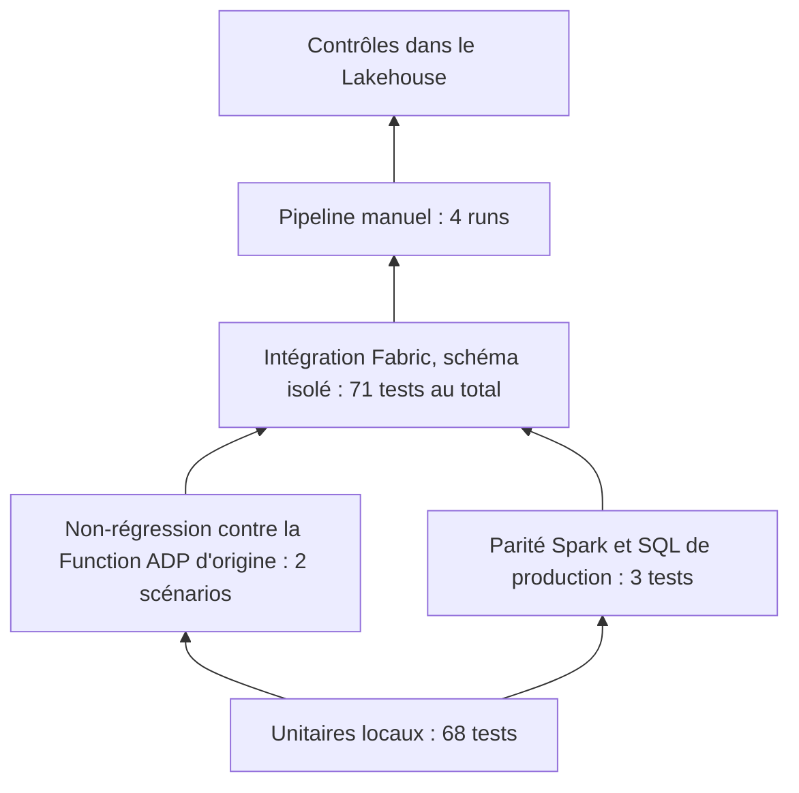

# Tests et preuves — dossier `TESTS`

Ce document détaille le dossier `TESTS`. Vue d'ensemble : [README](../README.md) · pipeline quotidien :
[QUOTIDIEN](../QUOTIDIEN/README_DETAILS.md) · traitements ponctuels : [ONESHOT](../ONESHOT/README_DETAILS.md).

**Sommaire** — [Contenu](#contenu) · [Tests et preuves](#tests) · [Démonstration](#demo)

---

## Contenu du dossier

| Objet (nom dans Fabric) | Dossier du dépôt | Rôle | Lancement |
|---|---|---|---|
| `T4_NB_HRIS_TESTS` | `NB_HRIS_TESTS.Notebook` | 13 modules de tests sur données fictives, scénarios d'intégration dans le schéma isolé `hris_tst`, rapport dans `zz_test_report` | à la main ; par `T4_PL_HRIS_BOOTSTRAP` avant tout run réel |

**Paramètres.** `p_test_schema` (`hris_tst`, jamais vide) ; `p_lakehouse_name` (obligatoire) ; `p_run_integration`
(`true` : scénarios avec écriture dans le schéma de test) ; `p_only` (filtre sur les identifiants de tests) ;
`p_fail_on_error` (`false` : rapport seul ; `true` : le notebook échoue après son rapport si un test échoue, ce que
demande le premier chargement) ; `p_log_cell_success`.

Le notebook ne lit ni n'écrit aucune table réelle. Les tables du schéma de test sont recréées à chaque campagne
d'intégration : ce schéma ne doit contenir aucune donnée à conserver.

## Tests et preuves

| Niveau | Contenu | Résultat |
|---|---|---|
| Unitaires locaux | parité T-SQL et règles, acquisition (faux serveur), publication (clients fictifs), import de logs, noms de tables, pipeline, marqueurs de contrat | **68 réussis** |
| Non-régression NR-03 | la Function ADP d'origine (fichier non modifié) et le portage exécutés localement contre le **même simulateur** : même séquence de requêtes d'écriture, mêmes corps JSON, mêmes lignes de log ; scénarios nominal et erreurs HTTP | **2 réussis** |
| Parité Spark | la transformation Spark égale l'implémentation de référence du SQL sur des cas limites | **3 réussis** (locaux, repris dans la campagne Fabric) |
| Prototype d'origine | 10 tests du garde-fou initial, conservé intact | **10 réussis** |
| Fabric, données fictives | schéma isolé `hris_tst`, contexte réel du workspace | campagne 1 : 65 tests, 1 erreur de test corrigée ; campagne 2 : 66, 0 échec ; **campagne 3 : 71, 0 échec**, sans Lakehouse par défaut ; 1 test ignoré dans Fabric (cohérence des marqueurs, vérifiée en local) |
| Analyse statique | syntaxe de 49 fichiers ; noms indéfinis des 10 notebooks (avec un contrôle positif) | **0 problème** |
| Correspondances par l'API (TST_4) | lecture des référentiels, fusion de la partie TalentSoft (ajouts, libellés, aucune suppression, aucune colonne ADP écrite), saisie ADP tout ou rien, grille collée (sélection `SELECT *` de l'existant, modèle de `REPORT` rempli, plusieurs tables, `NULL`, casse, codes obsolètes, erreurs d'en-tête et de ligne), contrôles non bloquants, aucune valeur journalisée ; faux client API, aucun réseau | **27 tests locaux** : 26 réussis, 1 test Spark ignoré hors Fabric ; 27 mutations du code toutes détectées ; exécution simulée du notebook d'administration (aller-retour `REPORT` → grille → `CHECK` → `APPLY` sur 9 tables) et de l'étape d'acquisition : 24 vérifications ; **non exécuté dans Fabric** |
| Flux rémunération et câblage ADP (TST_4) | règles des vues SQL (décimal, chaînes, clôtures, union), instantané, lecture des exports (JSON, CSV, archive), contenu d'import, garde-fou et avance de la référence, suivi des exports et imports, comparaison de structure ; encodage des chemins ADP (même cible que `requests`, validation réelle de `http.client`), jeton OAuth, fabrique verrouillée | **31 tests locaux** et 1 test Spark (Fabric) ; 10 mutations du flux toutes détectées ; exécution simulée du notebook : 10 vérifications ; **non exécuté dans Fabric** |
| Premier chargement guidé et rangement (TST_4) | choix du mode (référence vide ou non, verrou tenu, bail expiré ou inconnu), dernier statut par étape, action suivante pour chaque issue (abouti, hors PRD, codes ADP manquants, rémunération en échec, verrou concurrent, autre blocage, run introuvable) ; contrôle statique des deux pipelines (notebooks et pipeline appelés, paramètres transmis déclarés par la cible, activités citées dans les expressions, variables), avec un contrôle positif | **8 tests locaux** ; 13 mutations toutes détectées ; exécution simulée du notebook `T4_NB_HRIS_BOOTSTRAP` et des expressions du pipeline qui lisent sa sortie : 12 vérifications ; **non exécuté dans Fabric** |
| Sondes de plateforme | deux notebooks de sonde, sans Lakehouse par défaut | noms partiels et à 3 parties en échec ; 4 parties opérationnels |

**Scénarios d'intégration Fabric** : verrou et concurrence (deux acquisitions simultanées, une seule réussit, bail
expiré) ; premier chargement bloqué puis `INIT_REFERENCE` puis run courant avec outbox et garde-fou réel ; refus d'un
`INIT_REFERENCE` sur référence non vide ; lot vide ; revalidation après renseignement d'un seuil ; correspondance
manquante qui n'interrompt que l'enrichissement ; libération du verrou en fin de run.

**Scénarios de publication** (clients fictifs) : tous les noms de workspace, y compris `PREPRD`, `NOTPRD`, `prd` ;
intention durable avant envoi ; plantage avant, pendant et après l'envoi ; `2xx` inexploitable, `401`, `429`, `5xx`,
délai, redirection ; absence de retry et de renvoi ; dépendances ; deux modifications légitimes successives du même
champ ; obsolescence sans perte ; réconciliation ; décisions manuelles.

**Ce qui n'est pas prouvé.** Le premier chargement guidé et le `%run` d'un dossier à l'autre n'ont jamais été
exécutés dans Fabric. Aucune transformation sur données réelles, donc aucun contrôle de parité sur des données réelles
(les écarts `ISDATE` et `ISNUMERIC` ne sont pas mesurés) ; aucune publication.

**Où sont lancés les tests locaux.** Hors du dépôt, par un harnais qui charge les modules depuis les notebooks et
vérifie leurs empreintes avant de lancer les tests. Dans Fabric, lancer `T4_NB_HRIS_TESTS`.

## Parcours de démonstration (15 minutes, dans le plan)

| # | Montrer | Message |
|---|---|---|
| 1 | Les dossiers `TST_4/QUOTIDIEN`, `ONESHOT` et `TESTS` dans le workspace | les objets existent et sont rangés par usage |
| 2 | `VL_HRIS` : variables et absence de secret | séparation source, exécution, destination |
| 3 | Historique d'un run du pipeline : vue des activités du run en échec contrôlé | l'enchaînement, la gestion d'échec unique, le motif réel |
| 4 | `ctl.run`, `ctl.run_step`, `log.anomaly` pour ce run | le blocage est **tracé** (`TS_SECRET_RESOLUTION`), pas caché |
| 5 | Résultat du contrôle de Lakehouse sur ce run puis sur un run fictif | les contrôles distinguent réel et fixture, et ne mentent pas |
| 6 | Le run fictif complet : référence, outbox, décision du garde-fou | `DENIED_NON_PRD`, zéro transport, zéro tentative réseau |
| 7 | Les deux sondes de plateforme | pourquoi les noms de tables sont à quatre parties |
| 8 | Le diff Git préparé et la note de synchronisation | ce qui reste à autoriser |
